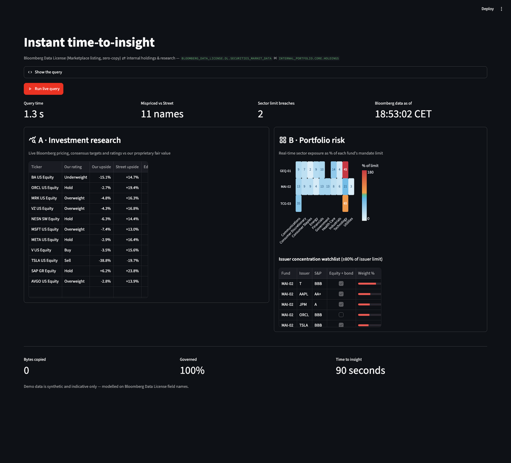

# Zero-Copy Bloomberg Data Sharing — 90-second demo

**Instant time-to-insight: combining Bloomberg market data with internal holdings in Snowflake.**

One SQL join between Bloomberg Data License market data (delivered as a zero-copy Marketplace listing) and a firm's
internal holdings answers two analyst questions in about a second — no CSV exports, no Excel glue, no reconciliation.

| | Use case | Question answered |
|---|---|---|
| **A** | Investment research | Where does our proprietary fair value diverge from the Street by ≥ 15 pts? |
| **B** | Portfolio risk | Which funds are near or over their sector and issuer concentration limits right now? |



> **All data is synthetic and indicative only.** Tickers, ISINs and Bloomberg field names (`PX_LAST`, `BEST_TARGET_PRICE`,
> `RTG_SP`, …) are modelled on Bloomberg Data License so the demo feels real, but prices, ratings, holdings and analyst
> views are generated. This is not Bloomberg data and not investment advice.

## What's in the repo

| File | Purpose |
|---|---|
| `01_setup_data.sql` | Creates `BLOOMBERG_DATA_LICENSE.DL` (stand-in for the listing) and `INTERNAL_PORTFOLIO.CORE` (holdings, portfolios, FX, analyst views) with deterministic synthetic data. Prices drift daily and tick on every query. |
| `02_demo_query.sql` | The two worksheet queries (research + sector risk) if you prefer to demo in a Snowsight worksheet. |
| `app/streamlit_app.py` | Streamlit in Snowflake app: live query button, research table, sector heatmap, issuer watchlist. |
| `docs/screenshots/` | Screenshots used in the README and presentation. |

> **Presenting this demo?** Read the [Presenter Guide](docs/PRESENTER_GUIDE.md) for prerequisites, a day-of checklist, Q&A and troubleshooting.

## Setup (≈ 5 minutes)

1. Run `01_setup_data.sql` in a Snowsight worksheet. Adjust the `USE ROLE` / `USE WAREHOUSE` lines at the top to your environment.
2. Deploy the app (container runtime, no external packages needed):

```sql
CREATE SCHEMA IF NOT EXISTS INTERNAL_PORTFOLIO.APPS;
CREATE STAGE  IF NOT EXISTS INTERNAL_PORTFOLIO.APPS.APP_STAGE;

-- from SnowSQL / Snowflake CLI, or upload via Snowsight
PUT 'file://app/streamlit_app.py' @INTERNAL_PORTFOLIO.APPS.APP_STAGE/zero_copy_demo
    AUTO_COMPRESS = FALSE OVERWRITE = TRUE;

CREATE OR REPLACE STREAMLIT INTERNAL_PORTFOLIO.APPS.ZERO_COPY_BLOOMBERG_DEMO
  FROM '@INTERNAL_PORTFOLIO.APPS.APP_STAGE/zero_copy_demo'
  MAIN_FILE       = 'streamlit_app.py'
  QUERY_WAREHOUSE = <your_warehouse>
  RUNTIME_NAME    = 'SYSTEM$ST_CONTAINER_RUNTIME_PY3_11'
  COMPUTE_POOL    = <your_compute_pool>
  TITLE           = 'Zero-Copy Bloomberg x Holdings';
```

3. Open the app in Snowsight → **Projects → Streamlit** and click **Run live query**.

To run locally instead: `pip install streamlit snowflake-connector-python[pandas] altair`, configure a connection in
`~/.snowflake/connections.toml`, then
`SNOWFLAKE_DEFAULT_CONNECTION_NAME=<conn> streamlit run app/streamlit_app.py`.

### Using a real Bloomberg listing

In a customer account, replace the `BLOOMBERG_DATA_LICENSE` database with the mounted Bloomberg Data License listing and
map the column names in `POSITIONS_CTE` (top of `app/streamlit_app.py`). Holdings tables join on `ID_ISIN`.

## The 90-second script

| Time | Beat | On screen |
|---|---|---|
| 0:00 | **Hook** — "Analysts lose ~80% of their morning to CSV exports, Excel glue and reconciliation before any analysis happens." | App title |
| 0:15 | **The query** — "Bloomberg's data sits in our account as a zero-copy listing. One join against our own holdings." | *Show the query* → **Run live query** |
| 0:45 | **Results** — "About a second. Card A: 11 names where our fair value disagrees with the Street. Card B: two sector breaches — GEQ-01 is 180% of its tech limit." | Cards A and B |
| 1:15 | **Takeaway** — "Live today across 32 Bloomberg Data License listings on Snowflake Marketplace, with 82 active data shares across 57 customers. Zero bytes copied, 100% governed, 90 seconds to insight." | Footer metrics |

## Notes

- Query time shown in the app is end-to-end (network + compile + execute); the three queries run in parallel.
- Timestamps are displayed in CET (`Europe/Paris`); change `CONVERT_TIMEZONE` in `RESEARCH_SQL` if needed.
- No credentials are stored in this repo. Don't commit `.streamlit/secrets.toml`.
